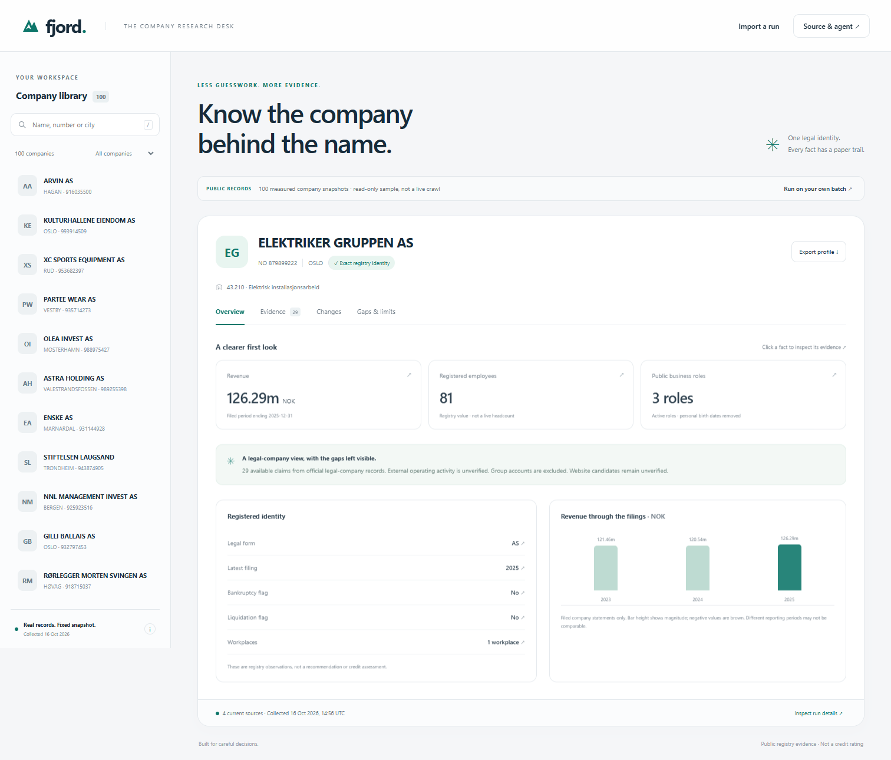

# Fjord

**Know the company behind the name.** An evidence-first Norwegian company research agent and responsive research desk, built for Signalpost. Work in progress; no official score or qualification claimed.

Fjord starts from a legal organisation number, keeps company accounts separate from group accounts, preserves missing values and reporting periods, and exposes the evidence behind each fact. Refresh compares observations without treating a new retrieval time as a changed fact. Failed lookups remain explicit result envelopes.



## Run the agent

Tested runtime: **CPython 3.12.14**, pinned in `.python-version`. No third-party Python packages, API keys, models or paid services. The standard library is the entire dependency set. An empty virtual environment works; `requirements.txt` contains no packages.

```sh
python agent.py --input data/smoke-input.jsonl --output out/run.jsonl --max-requests 500 --seconds 600
```

Replace the input with the evaluator's JSONL batch. Each nonblank line is a JSON string such as `"810034882"` or an object such as `{"organisation_number":"810034882"}`. Input order and duplicate lines are preserved. Malformed inputs receive failed envelopes. Do not replace official input with the bundled sample.

For a larger batch, set the organizer's supplied limits:

```sh
python agent.py --input official.jsonl --output out/official.jsonl --max-requests 6000 --seconds 2700
```

These limits are examples, not claims of the official budget. Default concurrency is six, capped at twelve. Requests start at least 350 ms apart per host. Public GETs permit one bounded network-error retry, six redirect hops, a 15-second total response deadline and a 2 MB body cap. Each HTTPS destination and redirect is checked against private/local addresses; connections pin the validated DNS address while retaining TLS hostname checks. Source errors and budget exhaustion stay visible.

### Refresh and compare

```sh
python agent.py --input data/smoke-input.jsonl --output out/refresh.jsonl --previous out/run.jsonl
```

Prior evidence remains attached. Changes distinguish value changes, availability changes, new observations and claims not observed in the refresh. A failed refresh is not proof that an earlier value became zero or ceased to exist.

### Evaluator-provided frozen identity

```sh
python agent.py --input official.jsonl --output out/official.jsonl --registry-snapshot registry.jsonl --registry-as-of 2026-10-16T00:00:00Z --max-requests 6000 --seconds 2700
```

The frozen file contains direct BRREG entity objects keyed by `organisasjonsnummer`. Missing anchors do not fall back to live identity. A stable evidence URN carries the file hash. Adapt explicitly if the evaluator provides another format. Accounts, roles and workplaces remain live observations.

## Open the research desk

```sh
python -m http.server 4174 --bind 127.0.0.1 --directory dist
```

Open `http://127.0.0.1:4174/`. The 100-company sample is labelled a fixed snapshot. Search by name, number or city; inspect source, date, hash and JSON location; compare financial periods; export a profile; import a fresh run locally. Files stay in browser memory and are not uploaded. UI import supports up to 10 MB and 1,500 unique valid envelopes. The CLI separately preserves duplicate and failed inputs.

Tabs support arrow keys, `/` focuses search, dialogs have accessible names and Escape dismissal, and reduced motion is respected. The gaps panel lists unsupported fields. Role-source privacy projection is visible in the inspector.

## Verify

```sh
python -m unittest -v
```

Tests cover wrong-company/group accounts, financial missingness/non-finite numbers, refresh semantics, role privacy, workplace attribution/pagination, private-network and redirect blocking, request budgets, malformed/duplicate inputs, frozen identity without live fallback and preservation of prior evidence. These tests are original to this project.

Desktop/mobile browser QA exercised all 100 profiles, search, source snapshots, tabs, gaps, export, local import and reduced-motion layout. Screenshots are under `docs/screenshots/`.

## Measured runs and limits

`reports/` contains measured 100-company run reports; `dist/sample.json` contains displayed observations. Completion, source availability, errors and costs are local execution measurements. They do not establish independently measured precision, external recall, qualification or a competition score. No API charges are incurred by the current public sources; operator infrastructure/network costs are excluded.

The current version collects official identity, accounts, active public business roles and registered workplaces. It does not verify operating websites or collect jobs, news, sentiment or social activity. This limit is material to Signalpost scoring and stays visible in the app. The deterministic synopsis describes retrieved evidence, not generated assumptions or a credit recommendation.

Modules: `core.py` attribution/change semantics; `network.py` bounded transport; `agent.py` workflow/batches/frozen input; `dist/` buildless UI. No private user data, entrant credentials or hidden caches are needed. See [DATA-SOURCES.md](DATA-SOURCES.md) for source attribution, licensing and access assumptions.

Code MIT, Sanjay P. Registry data Brønnøysundregistrene, NLOD 2.0. AI assistance was used for research, design, implementation and testing. Company values are retrieved observations. No claim is made that Sanjay personally authored every line or independently assessed every source.
